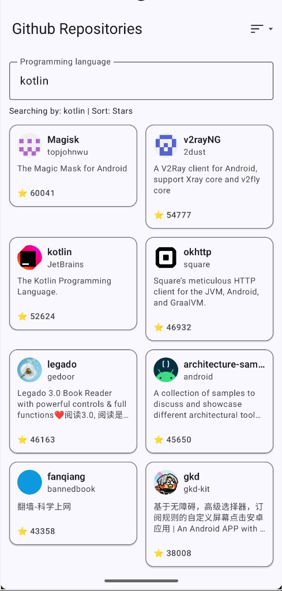
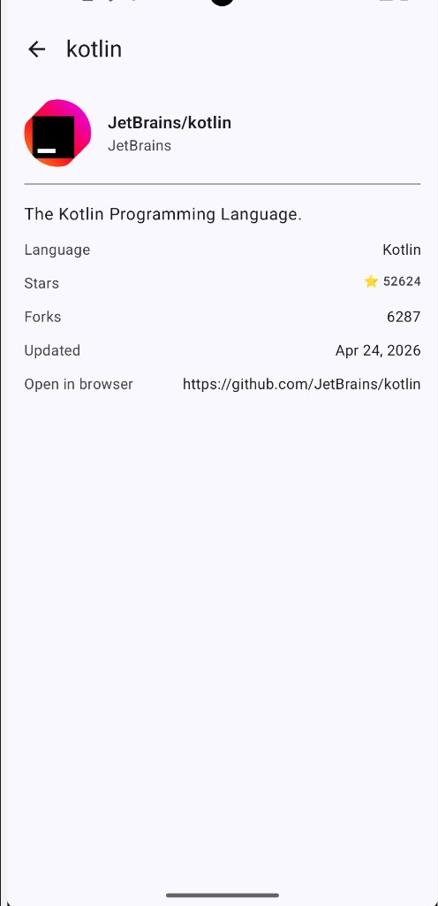

# GitScope

## Screenshots

Splash screen, repository search (language filter and sort), and repository details.

### Splash screen

### Repositories

### Repository details

## Architecture

This project follows an MVVM-based architecture with a clear separation between UI, state management, domain models, and data access.

### Layers

- `presentation`
    - Compose screens, reusable UI components, navigation routes and ViewModels.
    - Screens are stateless whenever possible and receive state/callbacks from Route composables.

- `domain`
    - App models and repository contracts.
    - Keeps the UI independent from API response models.

- `data`
    - API DTOs, mappers, Retrofit service and repository implementation.
    - Converts GitHub API responses into domain models before exposing them to the rest of the app.

- `di`
    - Hilt modules responsible for providing network and repository dependencies.

- `core`
    - Shared utilities used across the app, such as date formatting.

### State Management

The UI is driven by `StateFlow` exposed from ViewModels.  
Each screen reacts to its own UI state, including loading, success, empty and error scenarios.

### Dependency Injection

Hilt is used to inject dependencies into ViewModels and data classes through constructor injection.  
This keeps the UI layer decoupled from concrete implementations and makes testing easier.

## Development Approach (Step-by-step Evolution)

This project was built using an incremental approach, focusing on delivering a working user experience early and progressively integrating data, architecture, and quality improvements.

### Step 1 — Foundation

- Project setup with Jetpack Compose, Material 3, Navigation and Hilt
- App successfully builds and runs

#### 🤖 AI Usage
- Assisted in resolving Java/Gradle compatibility issues
- Suggested stable library versions and dependency setup

---

### Step 2 — UI with Mock Data

- Create package structure: `presentation`
- Initial NavHost configuration
- Implemented `RepositoriesScreen` with a 2-column grid
- Created reusable `RepositoryItem` composable
- Added Top App Bar: **"Github Repositories"**
- Displayed repository information
- Introduced mock data (`RepoPreview`) to simulate real content
- Added Coil for image loading

#### 🤖 AI Usage
- Generated mock data structure for repositories
- Assisted in creating initial Compose UI components
- Suggested preview configurations for faster UI iteration

---

### Step 3 — Navigation & Details Screen

- Implemented navigation using Navigation Compose
- Added `RepositoryDetailsScreen`
- Enabled navigation from repository list to details screen
- Passed repository identifier through navigation arguments
- Retrieved selected repository from mock data source
- Added ellipsized title in Top App Bar

#### 🤖 AI Usage
- Assisted in structuring navigation routes and arguments
- Helped define the initial structure of the details screen
- Suggested preview configurations for faster UI iteration

---

### Step 4 — ViewModel & UI State with Mock Data

- Added domain model `Repository`
- Moved mock repositories to a mock data source
- Introduced `RepositoriesViewModel`
- Introduced `RepositoryDetailsViewModel`
- Added UI state classes for list and details screens
- Updated screens to render state instead of owning mock data directly
- Added Route composables to connect ViewModels with UI screens

#### 🤖 AI Usage
- Assisted in defining the initial ViewModel structure
- Update preview configurations after refactoring

---

### Step 5 — Initial ViewModel Unit Tests

- Added unit tests for `RepositoriesViewModel`
- Added unit tests for `RepositoryDetailsViewModel`
- Created `MainDispatcherRule` to replace `Dispatchers.Main` during JVM tests

#### 🤖 AI Usage
- Suggested using `MainDispatcherRule` for coroutine-based ViewModel tests

---

### Step 6 — GitHub API Integration & Repository Layer

- Added GitHub REST API integration using Retrofit
- Added DTOs for repository search and repository details responses
- Added mappers to convert API responses into domain models
- Added the domain layer
- Added the data layer
- Added Hilt modules for network and repository dependencies

#### 🤖 AI Usage
- Assisted in structuring DTOs and mappers for the GitHub API response
- Helped define repository abstraction and Hilt modules

---

### Step 7 — Connect ViewModels to Data Source

- Updated `RepositoriesViewModel` to load repositories from the real GitHub API
- Updated `RepositoryDetailsViewModel` to load repository details from the API
- Added `@HiltViewModel` to ViewModels
- Injected dependencies using constructor injection with `@Inject`
- Replaced `viewModel()` with `hiltViewModel()` in Route composables
- Updated navigation arguments from `repoId` to `owner/repo`, matching the GitHub details endpoint
- Updated unit tests to use `MockGithubRepository`

#### 🤖 AI Usage
- Update navigation arguments to support GitHub API details requests

---

### Step 8 — Language Filter & Sorting Options

- Added a language search field to filter repositories by programming language
- Added sorting options for: stars, forks and last updated
- Updated `RepositoriesViewModel` to manage filter and sort state
- Updated API requests to use the selected language and sort option
- Added UI components for search and sorting

#### 🤖 AI Usage
- Defining the filter and sort state structure
- Create reusable Compose components for search and sorting

---

### Step 9 — Loading, Empty and Error State Handling

- Added loading state for repositories and details screens
- Added reusable `LoadingContent`, `ErrorContent`, and `EmptyContent` composables
- Added retry action for failed requests
- Added empty state when no repositories are returned
- Updated screens to render content based on UI state
- Improved UX feedback during network operations

#### 🤖 AI Usage
- Assisted in designing reusable state components
- Define the UI state rendering strategy
- Suggested retry handling for failed network requests

---

### Step 10 — Repository Details UX & Navigation Fix

- Improved `RepositoryDetailsRoute` with proper **loading, error, empty and success states**
- Added back navigation using `NavController.popBackStack()`
- Connected retry action to `RepositoryDetailsViewModel`
- Refactored `RepositoryDetailsScreen` with scrollable content
- Added `GithubDateFormatter` to format dates
- Improved TopAppBar title with `pendingTitle` while loading
- Updated reusable components (`LoadingContent`, `ErrorContent`, `EmptyContent`) to support padding and customization
- Fixed navigation route mismatch (`repo_details/{owner}/{repo}`)

#### 🤖 AI Usage
- Assisted in structuring the details screen layout
- Suggested improvements for navigation and state handling

---

### Step 11 — Compose UI Tests

- Added Compose UI tests for `RepositoriesScreen`
- Added UI test coverage for `RepositoryDetailsScreen`

#### 🤖 AI Usage
- Helped identify where test tags may be useful for clickable components

---

### Step 12 — Pull to refresh

- Pull-to-refresh on the repositories list

#### 🤖 AI Usage
- Wired refresh callback to the existing `loadRepositories` flow

---

### Step 13 — App Icon & Splash Screen

- Added a custom GitScope app icon using VectorDrawable
- Configured adaptive launcher icons
- Added Android SplashScreen API
- Updated the launch theme to show the app icon before loading the main screen

#### 🤖 AI Usage
- Creating a simple vector-based app icon
- Configure Android adaptive icons and SplashScreen theme

---

### Additional Improvements

- Basic offline support using in-memory cache:
    - The last successful repository list is cached
    - If the network request fails, cached data is displayed